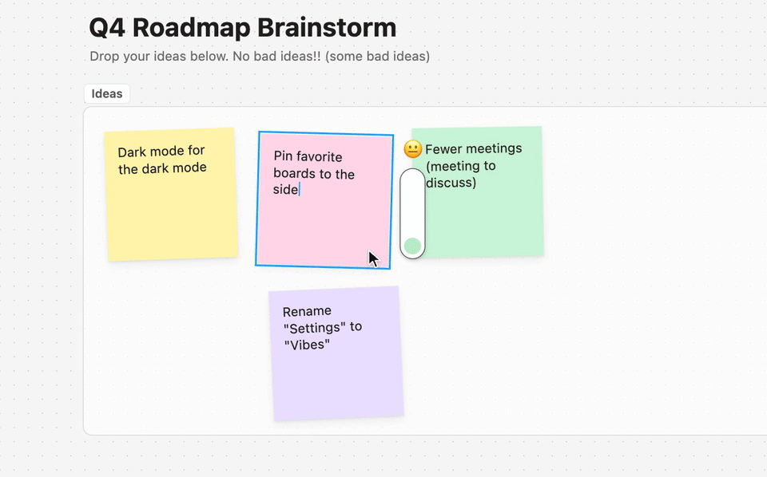

# Stage Fright

A FigJam plugin for people who can't work while someone is watching.



An anxiety bar hangs next to your cursor. Each person who scrolls you into view pushes it up a third. At three watchers it's full and red, and it starts to shake. When they scroll away it drains, more slowly than it filled. It also swings behind your cursor as you move, like it's barely holding on.

The full demo is in [media/stage-fright-demo.mp4](media/stage-fright-demo.mp4). It's a simulation with scripted collaborators, because three real people were not available to stare at me.

## Install

1. Open a FigJam board in the Figma desktop app.
2. Go to Plugins → Development → Import plugin from manifest, and pick `manifest.json` from this repo.
3. Run Stage Fright from Plugins → Development.

The plugin panel shows who is watching. Set Fake watchers to try it alone. "Calm down" removes the bar and closes the plugin.

## What to know

It only works in FigJam. Figma Design files don't give plugins any way to see other people's cursors or viewports.

Everyone in the file can see your bar. A plugin can't draw on just your screen, so the bar is a locked object on the board that keeps moving to your cursor.

Every move counts as an edit, so your undo history fills up while it runs. Close the plugin before you undo real work.

The plugin checks positions about 30 times a second, so the bar trails a little behind fast cursor moves. It hides when your mouse leaves the canvas.

## Development

```
npm install     # only needed to render the demo video
npm test
npm run build   # joins src/logic.js and src/plugin.js into code.js
npm run demo    # renders media/stage-fright-demo.mp4 (needs Google Chrome and ffmpeg)
```

`src/logic.js` holds the bar logic: watcher counting, fill speed, color, tremble, and swing. The plugin and the demo page in `demo/` both use it. `demo/typing.js` drives the typing in the video, and the fuller the bar, the more typos. Run `node demo/record.mjs --probe` to print the timeline without rendering frames.
